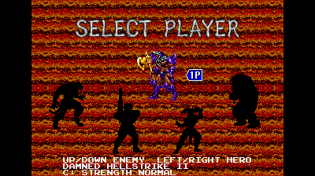
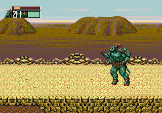
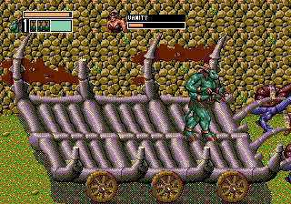
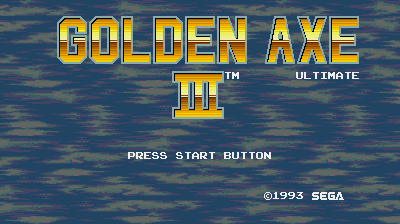
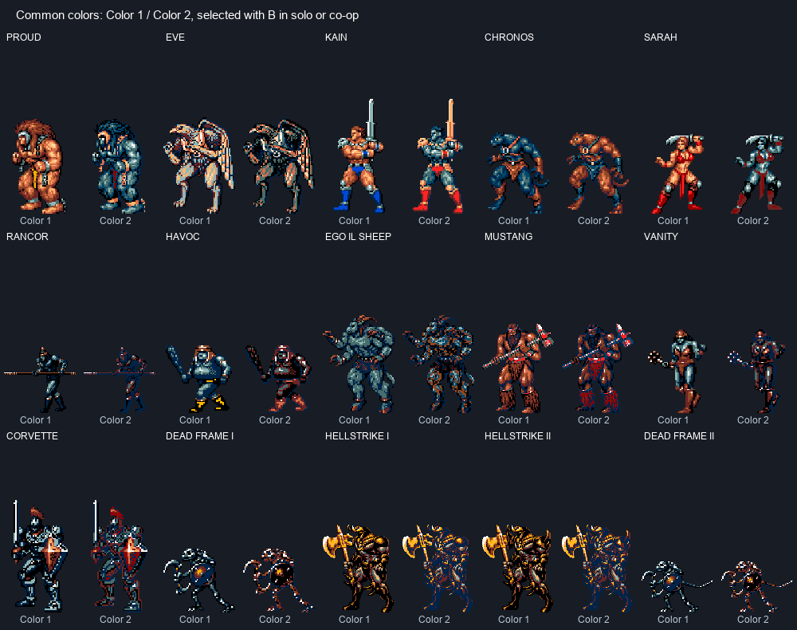
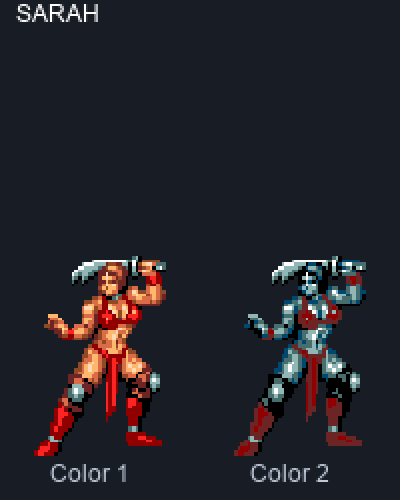
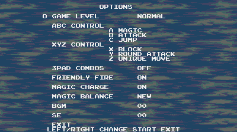
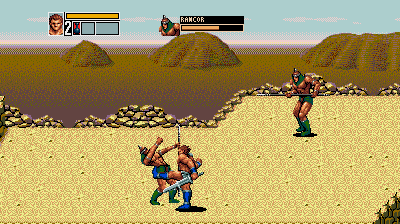
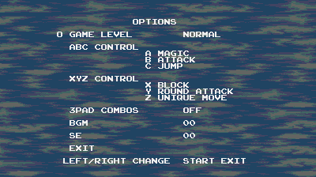

# Golden Axe III - Ultimate

**Version 1.4**

Play as enemies and bosses in single-player or two-player co-op, with independent color choices, configurable six-button controls, and an enemy health display.

## Playable bosses and remaining issues

Playable bosses have been fixed as far as possible. **The game has been completed using one of the bosses**, but there is no guarantee that every boss or enemy will work perfectly throughout the game.

Single-player offers original native boss colors, native darker variants, and two common-palette costumes. Co-op uses the two common-palette costumes, selected independently for each player. Some boss colors are approximated, and crowded fights with large bosses can still slow down. Boss pairs use safe greeting gestures; hero-only paired attacks are disabled when either player is a boss. The shared 10-bottle spell remains available.

## Features

- Play as enemies and bosses in single-player or two-player co-op, including duplicate characters.
- Choose each player's costume independently with B at character selection.
- Use their attacks and special moves, plus magic borrowed from the original heroes.
- Adjust ABC and XYZ button layouts in Options.
- Turn friendly fire off for two-player cooperative play in Options.
- Hold and release Magic to choose its power, with optional rebalanced bottle damage.
- See the enemy's portrait, name, and remaining health.
- Use the original player health, magic, and lives display.
- Versus keeps its original character selection.

## Download and installation

[Download the playable-enemies patch](Golden_Axe_III_PlayableEnemies.zip).

Apply `Golden_Axe_III_PlayableEnemies.ips` to your own copy of `Golden_Axe_III_(J)_[h1].bin`. Apply it to the original game, not an already patched version. This patch includes the six-button controls and enemy HUD.

The required original file is 1,048,576 bytes, with CRC32 `65F4D556` and SHA-1 `a602f49de6f006b9cd210049496098dc01a1ca10`. Other versions have not been tested. No game ROM is included.

Reopen the patched game and start fresh. Set your emulator's controller to six-button to use X, Y, Z, and Mode.

## Controls

- **Character selection:** each player chooses independently in co-op, and duplicate characters are allowed. Up/Down cycles through 11 enemy/boss forms; Left/Right returns to the original heroes. Bosses appear in the center with the selection marker on their right and the four heroes darkened. Press Start to confirm.
- **Colors:** press B at character selection. Solo bosses cycle Original, Dark, Color 1, and Color 2; original heroes skip Dark. Co-op offers Color 1 and Color 2 independently for each player.
- **Original heroes:** X blocks, Y uses the round attack, and Z uses the unique move.
- **Enemies and bosses:** X blocks or evades where supported; Y and Z use character-specific special moves.
- **Enemy strength:** press C at character selection to choose Normal or Strong. Strong uses the highest native close-combat damage values; Eve has one damage set. Magic and projectiles retain their existing damage.
- **Magic:** hold A (the default Magic button), then release to choose a 1-, 3-, or 6-bottle cast. Two nearby players facing each other can hold longer for a combined 10-bottle cast, using bottles from both players.
- **Magic options:** MAGIC CHARGE can be turned OFF for the original automatic selection. MAGIC BALANCE defaults to NEW: 6 / 20 / 48 / 90 HP for 1 / 3 / 6 / 10 bottles. LEGACY keeps 6 / 16 / 32 / 56 HP; combining charged selection with LEGACY displays NOT RECOMMENDED.
- **Options:** change ABC/XYZ layouts or enable the original three-button combinations.
- **Friendly fire:** set FRIENDLY FIRE to OFF in Options to prevent partner hits and grabs in two-player cooperative play. ON keeps the original behavior; Versus is unaffected.
- **Level select:** press A+B+C together at character selection.
- **Clear-screen cheat:** hold Mode and press Start during gameplay or camp. Clears visible enemies and makes dwarfs release their remaining items. Not available in Versus.

## Playable enemies and bosses in action

Choose an enemy or boss on the character-select screen.

Play as a boss with the original player health, magic, and lives display.

## Changes in version 1.4

- Added playable enemies and bosses to two-player co-op, with independent selection and duplicate characters.
- Added independent color choices: original and darker native boss palettes in solo, plus two shared-palette costumes in solo and co-op. Normal heroes skip the redundant Dark option.
- Improved performance during busy fights and background scrolling. Crowded fights with large bosses can still slow down.
- Fixed the crash when a playable boss faces its partner for the head-nod greeting. Bosses use valid gestures; unsupported paired attacks are blocked, while combined magic remains available.
- Reworked Sarah's second costume with blue skin, coordinated dark red clothing, and a silver sword.
- Added ULTIMATE below the right edge of AXE on the title screen.

## Changes in version 1.3

- Added charged magic selection, a flashing cast-cost preview, separate charge/balance options, and the combined 10-bottle cooperative cast.
- Improved boss selection: centered previews and lightning, a marker on the right, darkened heroes, and no duplicate hero entries in the enemy cycle.
- Fixed Dead Frame II's trailing sprite in gameplay, character selection, and map screens, preserving each form's original appearance.
- Reduced boss-player palette bookkeeping, improving crowded scenes and barrel-break performance. Brief slowdown and some palette approximations remain.

## Original controls-only edition

The earlier [six-button controls and enemy HUD edition](Golden_Axe_III_6Button_EnemyHUD_v1.0.zip) is also available without playable enemies or bosses.

